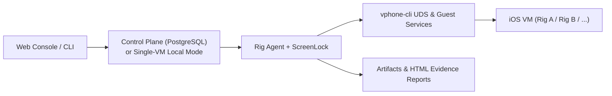

# Autophone

**English** | [简体中文](README.zh-CN.md)

**Deterministic iOS VM regression testing and multi-VM device control plane built on [`vphone-cli`](https://github.com/Lakr233/vphone-cli).**

Autophone turns jailbroken iOS virtual machines on Apple Silicon Macs into a traceable, isolated, and reproducible engineering test platform: it tracks device-built IPAs by exact **Build ID**, executes statically validated **Typed-IR Recipes** with **Vision OCR / Accessibility (AX) semantic targeting** (never delegating live regression verdicts to AI), serializes screen and system location access across multiple VMs via **ScreenLock**, and produces self-contained HTML evidence reports with step-by-step screenshots and logs.



> Explore the full component boundaries in the [Interactive Architecture Diagram](https://zhaoawd.github.io/autophone/architecture.html) (or open [docs/architecture.html](docs/architecture.html) locally), or jump straight to the [Quickstart Guide](docs/getting-started/quickstart.en.md).

---

## Why Autophone + `vphone`?

| Dimension | Xcode Simulator | Autophone + `vphone` | Physical iPhone |
| --- | --- | --- | --- |
| **Runtime** | Simulator runtime on macOS kernel | Isolated jailbroken iOS VM (`Virtualization.framework`) | Physical Apple hardware & stock iOS |
| **Target Artifact** | Simulator build | **Exact device-built IPA (Build ID + SHA-256 traced)** | Properly signed device IPA |
| **Sweet Spot** | Fast dev-time UI & unit debugging | Deterministic device-IPA regression, multi-VM control plane, location & process inspection | Real sensors/baseband, thermal/power profiling, pre-release device sign-off |
| **Boundaries** | Cannot validate device-only IPA builds | Virtualized hardware & jailbreak environment differences | Runtime instrumentation & fleet orchestration restricted by OS sandboxing |

See the [Testing Environment FAQ](docs/getting-started/faq.en.md) and [Environment & Verification Matrix](docs/getting-started/environment-matrix.en.md) for detailed trade-offs, verified configurations, and capability boundaries.

---

## Step 0: Zero-VM Offline Walkthrough

Clone the repository and install dependencies (`Python 3.11–3.13` + [`uv`](https://docs.astral.sh/uv/); see [Core Distribution & Standalone Install](docs/public-core.md) for wheel/sdist builds):

```bash
uv sync --locked --group platform --group contract
```

1. **Try the interactive VM-free Device Console demo** at `http://127.0.0.1:8000/embed/device-console?demo=1`:
   ```bash
   AUTOPHONE_STATE_DIR="$PWD/.tmp-state" uv run --group platform autophone serve --host 127.0.0.1 --port 8000
   ```
2. **Run offline Recipe validation & synthetic OCR positive/negative assertions**:
   ```bash
   uv run --group platform python scripts/verify_core_install.py examples/ios-settings-smoke
   ```

---

## Step 1: Single-VM IPA-Free Live Regression

Requires macOS with Xcode Command Line Tools. On first OCR use, Autophone compiles the bundled Swift Vision OCR helper into your user cache (or point `AUTOPHONE_OCR_BIN` to a prebuilt binary). Run `uv run python -m autophone.device.ocr_target probe` to verify host Vision OCR against a synthetic fixture.

Prepare `VPhone.bundle` and a schema v2 VM (e.g. `~/.vphone/machines/rig-a`) following the [`vphone-cli` upstream documentation](https://lakr233.github.io/vphone-cli/):

```bash
# 1. Auto-derive UDID from udid-prediction.txt and emit target.json with conflict-free ports
uv run --group platform autophone rig init rig-a --bundle /absolute/path/to/VPhone.bundle

# 2. Bring up VM + Web Console in single-VM local mode (no PostgreSQL required for a single --target)
AUTOPHONE_APP_ASSET_DIR="$PWD/examples/ios-settings-smoke" \
  uv run --group platform autophone rig up \
  --target "$HOME/.vphone/machines/rig-a/autophone/target.json"
```

Open `http://127.0.0.1:8000` and run the built-in English iOS Settings (`com.apple.Preferences`) smoke suite — **no third-party IPA or SpringBoard probe compilation required**:
- **`R1`** asserts `General` is visible on the Settings root list (`passed`).
- **`R2`** asserts a negative sentinel `AUTOPHONE_NEGATIVE_SENTINEL_404` and fails deterministically at the `assertion` stage (`failed`), preserving full HTML evidence reports for both runs.

> **Tip**: If an idle VM screen turns off before your first run (`app_ui_unavailable`), send two `Home` key presses from the Web Device Console to wake and unlock to the Home screen.

---

## Core Capabilities

| Capability | Typical CLI Entry Point | Documentation |
| --- | --- | --- |
| **Device Console & Embed** | `autophone serve --host 127.0.0.1 --port 8000` | [Device Console Guide](docs/guides/device-console.en.md) |
| **System Location & Route Replay** | `autophone location route --rig rig-a --owner op --session-id s1 example-demo-route-1p8km-driving` | [System Location Guide](docs/guides/location.en.md) |
| **IPA Package Store & Recording** | `autophone app package add example ./App.ipa --label v1.0` | [Packages & Recording](docs/guides/packages-and-recording.en.md) |
| **Typed-IR Deterministic Regression** | `autophone --app ios_settings_smoke --device rig-a run --ids R1 R2` | [Authoring Cases](docs/guides/authoring-cases.en.md) · [Verb Reference](docs/reference/verbs.md) |
| **Multi-VM PostgreSQL Control Plane** | `autophone rig up --ephemeral-db --target rig-a.json --target rig-b.json` | [Multi-VM Control Plane](docs/guides/multi-vm-control-plane.en.md) |
| **Host Preflight & Optional Probes** | `autophone doctor --human` / `scripts/build_guest_helpers.sh` | [Core Distribution](docs/public-core.md) |

## Documentation & References

> Onboarding guides (Quickstart, FAQ, Environment & Verification Matrix) and all core feature guides (Device Console, System Location, Packages & Recording, Authoring Cases, Multi-VM Control Plane, and Public Entry Point Extensions) are available in both English and Simplified Chinese; deeper architecture specs remain in Simplified Chinese, and CLI, Verb, Schema, and HTTP references are auto-generated from code truth and verified in CI.

- **Getting Started & Concepts**: [Docs Site](https://zhaoawd.github.io/autophone/) · [Quickstart (EN)](docs/getting-started/quickstart.en.md) ([中文](docs/getting-started/quickstart.md)) · [FAQ (EN)](docs/getting-started/faq.en.md) ([中文](docs/getting-started/faq.md)) · [Environment Matrix (EN)](docs/getting-started/environment-matrix.en.md) ([中文](docs/getting-started/environment-matrix.md)) · [Terminology](docs/concepts/terminology.md) · [Runtime Contract](docs/concepts/runtime-contract.md) · [Architecture Diagram](https://zhaoawd.github.io/autophone/architecture.html) ([local HTML](docs/architecture.html))
- **Core Feature Guides (Bilingual)**: [Device Console (EN)](docs/guides/device-console.en.md) ([中文](docs/guides/device-console.md)) · [System Location (EN)](docs/guides/location.en.md) ([中文](docs/guides/location.md)) · [Packages & Recording (EN)](docs/guides/packages-and-recording.en.md) ([中文](docs/guides/packages-and-recording.md)) · [Authoring Cases (EN)](docs/guides/authoring-cases.en.md) ([中文](docs/guides/authoring-cases.md)) · [Multi-VM Control Plane (EN)](docs/guides/multi-vm-control-plane.en.md) ([中文](docs/guides/multi-vm-control-plane.md))
- **Extensibility**: [Public Entry Point Extension Guide (EN)](docs/guides/extensions.en.md) ([中文](docs/guides/extensions.md)) · [Minimal Plugin Template](examples/plugin-template/README.md)
- **Auto-Generated References**: [Recipe Verbs](docs/reference/verbs.md) · [CLI Reference](docs/reference/cli.md) · [JSON Schemas](docs/reference/schemas.md) · [HTTP API](docs/reference/http-api.md)
- **Examples**: IPA-free iOS Settings smoke [examples/ios-settings-smoke](examples/ios-settings-smoke/apps/ios_settings_smoke) · Third-party App template [FOOD-ORDERING.md](FOOD-ORDERING.md)
- **Offline Platform Verification**: `scripts/test_public_platform.sh` (ephemeral Unix-socket PostgreSQL) · `npm run test:dashboard-e2e` (Playwright mock API) · [Platform Test Suite](tests/public_platform.txt)

## MCP Server

[`vphone_mcp/`](vphone_mcp/README.md) is a standalone Model Context Protocol (MCP) server for AI clients with `ScreenLock`-aware Control Plane coordination (`control_plane`, `local_lock`, and `managed_proxy` modes—failing closed whenever a configured Control Plane is unreachable, plus `VPHONE_MCP_REQUIRE_LOCK=1` to block uncoordinated standalone writes) and `upstream_v1` / `legacy` wire compatibility. It has passed 10/10 live end-to-end checks against a running `upstream_v1` `vphone-cli` VM (iOS `27.0.1 / 24A446`), covering `wait_ready`, `get_capabilities`, JPEG `screenshot` geometry, `list_apps`, location round-trip, local `ScreenLock` lifecycle/contention/quarantine, and Control Plane fail-closed + live reservation round-trip.

## Status & Roadmap

Autophone is currently in its `0.x` stage and is primarily maintained by a single maintainer (`@zhaoawd`). Public CLI, HTTP API, Recipe Verb, and Schema stability guarantees follow the [Versioning & Deprecation Policy](CHANGELOG.md#versioning--deprecation-policy). All four `0.2.x` roadmap focus areas have landed and been verified:

- **Graduate `vphone_mcp` from experimental** *(landed & live-verified)*: implemented `ScreenLock`/Control Plane fail-closed coordination and `upstream_v1` wire compatibility and passed 10/10 live end-to-end checks on a running `upstream_v1` VM (iOS `27.0.1 / 24A446`).
- **Optionalize PostgreSQL dependencies** *(landed)*: moved `psycopg[binary]` into the optional `autophone[postgres]` extra with lazy fail-closed imports so single-VM local mode and core wheel/sdist installs require zero PostgreSQL drivers.
- **Public Entry Point extension guide** *(landed)*: documented supported plugin hooks (`autophone.run_admission`, `autophone.executor`, `autophone.device_session`) in [docs/guides/extensions.en.md](docs/guides/extensions.en.md) with a runnable minimal template in [examples/plugin-template/](examples/plugin-template/README.md) and protocol verification tests.
- **Bilingual docs & environment matrix** *(landed, expanding)*: added English onboarding guides (Quickstart, FAQ, Extensions) and the [Environment & Verification Matrix](docs/getting-started/environment-matrix.en.md) covering verified Apple Silicon macOS + iOS `26.1` (`23B85`) & `27.0.1` (`24A446`) environments; broadening additional macOS/iOS version coverage remains ongoing.

Feedback, roadmap discussions, and Pull Requests are welcome via [GitHub Discussions](https://github.com/zhaoawd/autophone/discussions), [Issues](https://github.com/zhaoawd/autophone/issues), and [CONTRIBUTING.md](CONTRIBUTING.md).

## Acknowledgements

Autophone stands on the shoulders of [**`Lakr233/vphone-cli`**](https://github.com/Lakr233/vphone-cli). Early iterations of Autophone were forked and adapted directly from `vphone-cli` before converging on its upstream `upstream_v1` UDS/vsock runtime protocol and VM lifecycle model. Huge thanks to [@Lakr233](https://github.com/Lakr233) and all `vphone-cli` contributors for making Apple Silicon iOS virtualization accessible to engineering and security research workflows.

## Community & License

Licensed under the [Apache License, Version 2.0](LICENSE) (see [NOTICE](NOTICE) for copyright and upstream attribution).

[Contributing](CONTRIBUTING.md) · [Code of Conduct](CODE_OF_CONDUCT.md) · [Security Policy](SECURITY.md) · [Release Notes](RELEASE-NOTES.md) · [Changelog](CHANGELOG.md)
