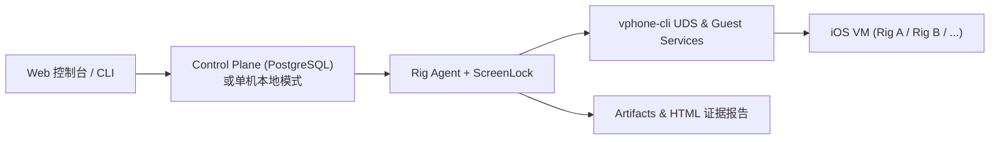

# Autophone

[English](README.md) | **简体中文**

**面向 [`vphone-cli`](https://github.com/Lakr233/vphone-cli) 的确定性 iOS 回归测试与多 VM 设备控制面。**

Autophone 在 macOS 上将越狱 iOS 虚拟机封装为可追溯、可隔离、可复现的工程测试平台：按精确 **Build ID** 管理设备版 IPA、用 **OCR / AX 语义寻址** 与静态校验的 **Typed-IR Recipe** 执行回归（正式运行期不依赖 AI 临场决策）、通过 **ScreenLock** 串行保护多 Rig 屏幕与系统定位会话，并自动沉淀截图、日志与 HTML 证据报告。



第一次运行可选用系统自带的英文 Settings。R1 应在主列表识别到 `General` 并通过；R2 应因找不到 `AUTOPHONE_NEGATIVE_SENTINEL_404` 而断言失败。两份 HTML 报告分别保留步骤和截图。[快速开始](docs/getting-started/quickstart.md) · [交互式架构图（在线预览）](https://zhaoawd.github.io/autophone/architecture.html)（或本地打开 [docs/architecture.html](docs/architecture.html)）

## 为什么选 Autophone + `vphone`？

| 比较项 | Xcode Simulator | Autophone + `vphone` | 实体 iPhone |
| --- | --- | --- | --- |
| 运行环境 | Mac 内核模拟器运行时 | 独立越狱 iOS 虚拟机 | 物理硬件与真实 iOS |
| 被测构建 | Simulator 编译产物 | **指定设备版 IPA（Build ID 追溯）** | 满足签名要求的设备版 App |
| 核心优势 | 开发期快速调试与布局验证 | 设备版 IPA 确定性回归、多 VM 控制面、定位/进程观测 | 真实硬件、性能功耗与发布前机型确认 |
| 适用边界 | 不可替代设备版 IPA 验证 | 存在虚拟硬件与越狱环境差异 | 进程插桩与自动化编排受系统权限限制 |

更多环境选型与能力边界见 [FAQ](docs/getting-started/faq.md)。

## Step 0：零 VM 离线体验

从源码克隆即可运行（Python `3.11`–`3.13` + `uv`；wheel 本地构建与独立安装见[核心分发安装与验证](docs/public-core.md)）：

```bash
uv sync --locked --group platform --group contract
```

1. **体验免设备交互控制台**：启动本地看板后，浏览器打开 `http://127.0.0.1:8000/embed/device-console?demo=1`：
   ```bash
   AUTOPHONE_STATE_DIR="$PWD/.tmp-state" uv run --group platform autophone serve --host 127.0.0.1 --port 8000
   ```
2. **体验离线 Recipe 校验与合成 OCR 正反例断言**：
   ```bash
   uv run --group platform python scripts/verify_core_install.py examples/ios-settings-smoke
   ```

## Step 1：单台 `vphone` 运行免 IPA 真机回归

宿主需要 macOS 和 Xcode Command Line Tools。首次 OCR 会将随包 Swift 源码编译至用户缓存；可用 `AUTOPHONE_OCR_BIN` 指定已有可执行文件。示例使用英文 Settings 主列表。运行 `uv run python -m autophone.device.ocr_target probe` 可先用固定图片检查原生识别。

按照 [vphone-cli 上游文档](https://lakr233.github.io/vphone-cli/) 准备 `VPhone.bundle` 与 schema v2 VM（例如 `~/.vphone/machines/rig-a`）：

```bash
# 1. 自动读取 udid-prediction.txt 并生成 target.json（无需手填 16 字段）
uv run --group platform autophone rig init rig-a --bundle /absolute/path/to/VPhone.bundle

# 2. 单机模式一键拉起 VM + 看板（单个 --target 无需预装 PostgreSQL）
AUTOPHONE_APP_ASSET_DIR="$PWD/examples/ios-settings-smoke" \
  uv run --group platform autophone rig up \
  --target "$HOME/.vphone/machines/rig-a/autophone/target.json"
```

打开 `http://127.0.0.1:8000`，展开“**用例回归、IPA 与录制**”，直接对系统自带“设置”（`com.apple.Preferences`）运行正向用例 `R1` 与负向对照 `R2` 并打开 HTML 证据报告——**全程无需第三方 IPA，也无需编译 SpringBoard 探针**。完整步骤见[快速开始](docs/getting-started/quickstart.md)。

## 核心能力导览

| 能力域 | 典型 CLI 入口 | 详细文档 |
| --- | --- | --- |
| **设备控制台与嵌入** | `autophone serve --host 127.0.0.1 --port 8000` | [设备控制台与嵌入](docs/guides/device-console.md)（[EN](docs/guides/device-console.en.md)） |
| **系统定点与路线回放** | `autophone location route --rig rig-a --owner op --session-id s1 example-demo-route-1p8km-driving` | [系统定位与路线回放](docs/guides/location.md)（[EN](docs/guides/location.en.md)） |
| **IPA 构建库与网页录制** | `autophone app package add example ./App.ipa --label v1.0` | [IPA 构建库与录制回放](docs/guides/packages-and-recording.md)（[EN](docs/guides/packages-and-recording.en.md)） |
| **Typed-IR 确定性回归** | `autophone --app ios_settings_smoke --device rig-a run --ids R1 R2` | [编写用例与 Recipe](docs/guides/authoring-cases.md)（[EN](docs/guides/authoring-cases.en.md)） · [Verb 参考手册](docs/reference/verbs.md) |
| **多 VM PostgreSQL 控制面** | `autophone rig up --ephemeral-db --target rig-a.json --target rig-b.json` | [多 VM 控制面部署](docs/guides/multi-vm-control-plane.md)（[EN](docs/guides/multi-vm-control-plane.en.md)） |
| **环境体检与可选探针** | `autophone doctor --human` / `scripts/build_guest_helpers.sh` | [核心分发安装与验证](docs/public-core.md) |

## 文档与参考

- **快速上手与概念**：[在线文档站](https://zhaoawd.github.io/autophone/) · [快速开始](docs/getting-started/quickstart.md)（[EN](docs/getting-started/quickstart.en.md)） · [FAQ](docs/getting-started/faq.md)（[EN](docs/getting-started/faq.en.md)） · [环境与验证矩阵](docs/getting-started/environment-matrix.md)（[EN](docs/getting-started/environment-matrix.en.md)） · [核心术语](docs/concepts/terminology.md) · [回归运行期契约](docs/concepts/runtime-contract.md) · [交互式架构图](https://zhaoawd.github.io/autophone/architecture.html)（[本地 HTML](docs/architecture.html)）
- **核心使用指南（中英双语）**：[设备控制台与嵌入](docs/guides/device-console.md)（[EN](docs/guides/device-console.en.md)） · [系统定位与路线回放](docs/guides/location.md)（[EN](docs/guides/location.en.md)） · [IPA 构建库与录制回放](docs/guides/packages-and-recording.md)（[EN](docs/guides/packages-and-recording.en.md)） · [编写用例与 Recipe](docs/guides/authoring-cases.md)（[EN](docs/guides/authoring-cases.en.md)） · [多 VM 控制面部署](docs/guides/multi-vm-control-plane.md)（[EN](docs/guides/multi-vm-control-plane.en.md)）
- **扩展与插件**：[公开 Entry Point 扩展指南](docs/guides/extensions.md)（[EN](docs/guides/extensions.en.md)） · [最小插件模板](examples/plugin-template/README.md)
- **代码自动生成参考**：[Verb 动作手册](docs/reference/verbs.md) · [CLI 命令参考](docs/reference/cli.md) · [核心 Schema 字典](docs/reference/schemas.md) · [HTTP API 目录](docs/reference/http-api.md)
- **示例资产**：免 IPA 系统设置示例 [examples/ios-settings-smoke](examples/ios-settings-smoke/apps/ios_settings_smoke) · 第三方 App 模板 [FOOD-ORDERING.md](FOOD-ORDERING.md)
- **离线平台验收**：`scripts/test_public_platform.sh`（需本机 PostgreSQL 工具链） · `npm run test:dashboard-e2e`（Playwright 模拟 API） · [平台验收清单](tests/public_platform.txt)

## MCP 服务

[`vphone_mcp/`](vphone_mcp/README.md) 是面向 AI 客户端的独立 Model Context Protocol（MCP）服务包，支持受 Control Plane / `ScreenLock` 协调的安全会话机制（`control_plane`、`local_lock`、`managed_proxy` 三种协同模式，配置控制面不可达时严格 fail-closed，独立模式支持 `VPHONE_MCP_REQUIRE_LOCK=1` 写保护）及 `upstream_v1` / `legacy` 线协议兼容。已在运行中的 `upstream_v1` `vphone-cli` 虚拟机（iOS `27.0.1 / 24A446`）上通过 10/10 实机闭环验收（涵盖 `wait_ready`、`get_capabilities`、JPEG `screenshot` 几何校验、`list_apps`、系统定位往返、`local_lock` 生命周期/争用/隔离以及 Control Plane 不可达拒止与真实租约往返），已正式去除实验标记。

## 维护状态与路线图（Status & Roadmap）

Autophone 当前处于 `0.x` 阶段，主要由个人维护者（`@zhaoawd`）主导维护，公开 CLI、HTTP API、Recipe Verb 与 Schema 的兼容承诺遵循[版本兼容与废弃策略](CHANGELOG.md#versioning--deprecation-policy)。`0.2.x` 阶段四项重点方向均已落地并完成验证：

- **`vphone_mcp` 上游真机验收与转正**（已落地并真机验收）：已完成 Control Plane / `ScreenLock` fail-closed 协同与 `upstream_v1` 协议兼容，并在运行中的 `upstream_v1` VM（iOS `27.0.1 / 24A446`）通过 10/10 实机验收，正式转正。
- **可选化 PostgreSQL 依赖**（已落地）：已将 `psycopg[binary]` 移入可选 extra `autophone[postgres]` 并完成惰性导入与 fail-closed 报错，基础 wheel/sdist 安装与单机本地模式不再拉取 PostgreSQL 驱动。
- **公开 Entry Point 扩展指南**（已落地）：已在[公开 Entry Point 扩展指南](docs/guides/extensions.md)文档化 `autophone.run_admission`、`autophone.executor`、`autophone.device_session`，并提供可运行的最小插件模板 [examples/plugin-template/](examples/plugin-template/README.md) 与协议验证测试。
- **双语文档与环境矩阵补齐**（已落地，持续扩展）：已补齐英文版快速开始、FAQ、扩展指南与[环境与验证矩阵](docs/getting-started/environment-matrix.md)（已覆盖 Apple Silicon macOS + iOS `26.1`（`23B85`）与 `27.0.1`（`24A446`））；后续持续扩展更多 macOS / iOS 真机镜像覆盖。

欢迎通过 [GitHub Discussions](https://github.com/zhaoawd/autophone/discussions)、[Issues](https://github.com/zhaoawd/autophone/issues) 与 Pull Request 参与讨论与共建（详见 [CONTRIBUTING.zh-CN.md](CONTRIBUTING.zh-CN.md)）。

## 致谢（Acknowledgements）

Autophone 的底层运行基础源自上游开源项目 [**`Lakr233/vphone-cli`**](https://github.com/Lakr233/vphone-cli)。本项目早期基于 `vphone-cli` 的 fork 进行探索与工程适配，现已全面收敛对齐上游 `upstream_v1` UDS/vsock 通信协议与虚拟机生命周期管理。衷心感谢 [@Lakr233](https://github.com/Lakr233) 及所有 `vphone-cli` 贡献者在 Apple Silicon iOS 虚拟化领域奠定的卓越基础。

## 开源许可与参与

本项目采用 [Apache-2.0 许可证](LICENSE) 发布（版权与上游致谢声明见 [NOTICE](NOTICE)）。

[参与开发](CONTRIBUTING.zh-CN.md) · [行为准则](CODE_OF_CONDUCT.md) · [安全反馈](SECURITY.md) · [发布说明](RELEASE-NOTES.md) · [变更记录](CHANGELOG.md)
