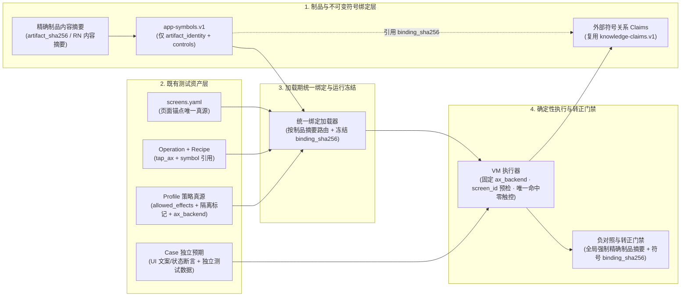

# iOS App 受控操作与确定性验证架构蓝图

> **文档状态**：架构边界与演进蓝图（v1.0，**Round 1、Round 1.5、阶段二与阶段三均已落地并完成真机验证**）。当前阶段一（Round 1 M1–M6）、Round 1.5（`ax_dump-v9` 遮挡加固，5/5 真机验证）、阶段二（API 与数据模型联合判定，9/9 真机全绿）以及阶段三（`guest_axruntime` 独立探针 STRONG GO、Stage 3B 接入、20/20 零 Frida 多应用交替长跑并正式晋升为默认 AX 后端，`frida_inproc` 保留为显式可选灰盒后端）已全部落地闭环。核心符号契约见 [统一 App 符号头文件（`app-symbols.v1`）最小契约规格](app-symbols-v1.md)；Guest 免侵入 AX 规格见 [Guest 免侵入 AX 观测与双通道静态分治规格](guest-ax-observation.md)；分阶段工程拆分与落地台账见 [受控操作与符号绑定分阶段实施任务书](app-symbols-v1-plan.md)；全阶段目标 VM 实测结论见 [实测验证报告](app-symbols-v1-validation-report.md)；当前运行期硬约束见 [回归运行期契约](runtime-contract.md) 与 [核心术语与概念模型](terminology.md)。

---

## 一、核心目标与裁剪原则

### 1.1 最值得保留的三个核心目标
移动端确定性回归的首要矛盾不在于构造复杂的编译语言，而在于以可接受的维护成本可靠守住三条底线：

1. **确认跑对了包**：逻辑控件 ID、不可变制品内容摘要绑定、外部确认态运行观测三者严格分离；即使版本号三元组相同，换包后既不混用旧观测，也不允许复用旧包或缺少精确制品摘要的负对照转正证据。
2. **确认点对了控件**：在加载期固定定位规则，在点击期复用页面真源核验目标 `screen_id` 并强制校验区域内唯一可操作命中，禁止同域多节点盲选首项，禁止静默退回坐标盲点，禁止对符号步骤静默关弹窗绕过遮挡。
3. **确认产品出错时测试会失败**：定位器只负责找到入口，`Case` 独立规定产品预期，资产转正必须经过 `negative_control` 区分力取证并绑定精确制品摘要与符号绑定摘要，防止弱断言假绿放行线上缺陷。

### 1.2 首版架构取舍：依托现有闭环，舍弃“交付四层编译器”里程碑
现有的 `Case`、`Recipe`、`Operation`、封闭动作集（`ACTIONS`）、`screens.yaml` 与 `promotion.py` 转正流程已足以承载第一轮实验。因此首版明确执行以下裁剪：

- **不扩充封闭动作表、不做重型编译器**：在现有 `tap_ax` 上补齐 `screen_id` 单帧前置核验与 `require_unique`，`Recipe` 通过 `action: tap_ax` + `symbol: <id>` 引用符号，由 `case lint`、准入与执行器共用的统一绑定加载器在加载期解析为冻结参数与元数据（保持 1:1 `step_index`）。
- **不可变绑定与可变观测物理拆离**：`app-symbols.v1` 文件只存不可变的 `artifact_identity + controls`（原始文件字节即 `binding_sha256`）；所有 `relation_claims` 独立存入外部 claims 文件（复用 `knowledge-claims.v1` 规范），消除循环哈希与观测写入导致的绑定自失效。
- **按真实痛点延后扩展特性**：多步 `$param` 等到出现重复维护的具体 `Operation` 再做；`routes`、`data_sources`、分层组合 `Screen` 与面向 Agent 的第二种运行模式，各自等到出现明确用例需求再排期。
- **保留现有成熟断言手段**：现有 Vision OCR 与 AX 断言继续承担用户可见文案的独立验证，不因引入符号层而废弃。

### 1.3 场景定位与已确认推进顺序（Track A：L2 先行 + 同包 L1 盲测）

| 层级 | 典型输入场景 | 首轮接入与验证路径 |
| :--- | :--- | :--- |
| **L2：自有源码构建** | 自研主力 App、自有源码测试工程（Swift / ObjC / React Native） | 由构建侧提供薄清单结合 Package Store 精确制品摘要生成 `app-symbols.v1` 与初始 claims，在两版构建上实测跨版本复用与维护成本 |
| **L1：无源码未加密 IPA** | 跨团队交付包、历史归档包、合规自备未加密 IPA | 首轮仅对未加密 RN IPA 的 `main.jsbundle` 做最小候选提取（`static_hint`，副作用初始标为 `unknown`），经隔离草稿试跑与人工确认边界后准入 |

- **已确认推进顺序（Track A）**：首轮先在自有项目 `Food Ordering`（L2）跑通最小符号闭环与两版跨版本对照，再用同一个 IPA 跑 L1 最小 RN 盲提取对照并统计双分母指标，凭实测数据决定后续是否投入原生 Mach-O 静态提取器。

### 1.4 战略非目标（Non-Goals）

> [!CAUTION]
> 以下四条红线在任何演进阶段均不突破：

1. **不做无安装包支撑的纯截图盲操通用框架**。
2. **不做 DRM 脱壳、重签绕过与商业风控对抗工具**：输入边界严格限定为已合法就绪的未加密 IPA（对齐 [核心分发安装与验证](../public-core.md)）。
3. **不在 `Recipe` IR 中引入图灵完备控制流**：动作名、目标符号与副作用集合必须在加载期静态确定。
4. **不用内部跳屏捷径替代被测主路径的真实物理交互，也不拿同包提取词表自证产品文案断言**。

---

## 二、受控执行与分层验证闭环

---

## 三、关键边界议题与分阶段落地闭环

### 3.1 首轮落实的四项基础工程闭环（已落地并由 Round 1.5 加固）
详见 [`app-symbols.v1` 规格 §二](app-symbols-v1.md) 与 [分阶段实施任务书](app-symbols-v1-plan.md)：
1. **制品摘要自动路由与全局转正新鲜度校验**：符号文件按纯制品内容摘要归档并在 Run 期自动路由；`autophone/assets/promotion.py` 全局升级为强制校验精确制品内容摘要（同版本号异包或缺失摘要的旧证据一律判 `discrimination_stale`），并对绑定符号的资产强制校验 `binding_sha256`。
2. **扩展 `tap_ax` 落实 `screen_id` 预检、唯一命中与遮挡 fail-closed**：复用 `screens.yaml` 做点击前单帧核验；修复仅按 `identifier` 定位时多节点选首项的缺陷，强制多命中零触控；首轮先不强改 `ax_dump.dylib`、在符号步骤禁用自动关弹窗静默绕过以在目标 VM 实证顶层弹窗遮挡表现，随后据此在 **Round 1.5** 落地 `ax_dump-v9` 遮挡加固与四层门禁并通过 5/5 真机验证。
3. **多副作用逐项核验与 `lower_bound` / `unknown` 机器门禁**：`EffectDecision` 升级为 `verbs` 集合 + `completeness`，多副作用符号动作拒绝 `"irreversible"` 通配符；`active` 严禁 `lower_bound` / `unknown`，`draft` 试跑须同时满足 CLI 显式确认与 `profile.yaml` 隔离数据声明。
4. **`ax_backend` 端到端契约贯通**：在 `app-profile.v1.json` 固定 `capabilities.ax.backend`（Round 1 初始默认 `frida_inproc`，阶段三完成 20/20 零 Frida 长跑后已正式晋升为默认 `guest_axruntime`，`frida_inproc` 保留为显式可选灰盒后端），贯通至 `AxSession`、AX 快照、Run 证据与 `unique_visibility` claim，跨后端结论不静默混用。

### 3.2 业务对象正确性与 API / 数据模型联合判定（阶段二已落地，9/9 真机验证）

> [!NOTE]
> **演进状态更新**：仅靠页面 UI 无法完整证明业务对象正确性这一核心边界在第一轮刻意保持在范围之外；目前**阶段二（API 与业务数据模型联合判定契约）已全部落地**（`entity-binding.v1`、动作后 `fixture_readback`、`api_oracle` 窗口实体断言与 fail-closed `joint_verdict`），并在目标 VM 完成 **S2-1–S2-7 全链路 9/9 真机验证**（含 `guest_axruntime` + `api_capture` 共存闭环，详见 [实测验证报告](app-symbols-v1-validation-report.md)）。

当页面类型与控件 ID 都匹配时（例如：点击门店列表进入了**另一家门店**的菜单页，页面控件结构完全合法；或点击提交后前端乐观更新了 UI，但后端接口实际报错或写入了错误的业务参数），单靠 UI 平面的 `Screen` 锚点与文本断言存在结构性盲区：

1. **业务内容判定必须结合后端 API 数据或数据模型**：
   完整的业务验证需要把**输入测试数据（预期实体 ID / 预期状态）**、**交互触发窗口内的 API 请求与响应载荷（`api_capture` + `api_mark`）**、**本地或服务端数据模型回读（`fixture_readback`）** 与 **页面 UI 呈现** 关联起来共同裁决。
2. **现有能力与阶段二契约的分层边界**：
   - 仓库现有的 `autophone/_data/schemas/field-binding.v1.json` 仅用于登记“后端配置/响应 JSONPath 驱动哪个页面区域”的类级因果关系（其 Schema 明确规定标准化 endpoint 不含具体门店、商品、账号、订单实例 ID），不能直接充当用例级的业务实体断言契约；
   - 第一轮聚焦 **“制品绑定 + UI 控件唯一寻址 + 多副作用准入 + UI 区分力门禁”**，先用独立测试数据固定预期对象并验证“页面对、对象错”反例；
   - **阶段二**在此基础上落地了用例级 `entity-binding.v1` 实体绑定、交互窗口 `api_capture` 模型断言、`fixture_readback` 动作后回读与 UI × API × 回读 fail-closed 联合裁决（`joint_verdict`），已完整覆盖错实体、乐观 UI + HTTP 500、陈旧回读与弱联合负对照等反例并通过 9/9 真机验真。

### 3.3 Guest 免侵入 AX 观测的节奏控制（阶段三已落地并晋升为默认后端）
同一次运行固定 `ax_backend`、在观测证据中端到端记录并核对 `ax_backend` 已于第一轮落地；随后**阶段三**按既定实测门禁完成进程外 `guest_axruntime` 独立探针四项对比实测（**STRONG GO**）、Stage 3B `AxSession` 接入、零 Frida 运行期加固及目标 VM **20/20 多应用零 Frida 交替长跑**（46/46 探针 0% 失败、0 `Tag: 255`、0 VoiceOver）。`guest_axruntime` 现已正式晋升为默认 AX 后端，`frida_inproc` 保留为显式可选灰盒后端，同时继续保持不改动上游 `vphoned`（独立探针按内容摘要缓存部署）；详见 [Guest 免侵入 AX 观测与双通道静态分治规格](guest-ax-observation.md) 与 [实测验证报告](app-symbols-v1-validation-report.md)。

---

## 四、务实演进顺序总览

具体里程碑拆分、涉及模块、提交记录与验收门禁见 [受控操作与符号绑定分阶段实施任务书](app-symbols-v1-plan.md)，真机实证汇总见 [实测验证报告](app-symbols-v1-validation-report.md)。

| 阶段 | 当前状态 | 目标与触发条件 | 核心交付与验收判据 |
| :--- | :--- | :--- | :--- |
| **阶段一（Round 1 · M1–M6）& Round 1.5**：最小符号闭环、双分母实测与进程内遮挡加固 | **已落地并真机验证**（Round 1 全量 + Round 1.5 5/5 零误报） | 在不扩充封闭动作表的前提下跑通三项核心目标并量化真实维护成本，并修补进程内弹窗遮挡穿透 | 1. 落地不可变 `app-symbols.v1` + 独立 claims、制品摘要自动路由、`tap_ax`（`screen_id` + `require_unique`）、多副作用与隔离试跑门禁、`promotion.py` 全局精确制品新鲜度与 `ax_backend` 贯通 2. 完成 L2 薄清单导入 + L1 RN `main.jsbundle` 最小提取器、离线 6 项反例单测、`Food Ordering` 两版真机对照与双分母账本，以及 Round 1.5 `ax_dump-v9` 遮挡加固（5/5 真机全绿） |
| **阶段二（专项二）**：API 与业务数据模型联合判定契约 | **已落地并真机验证**（S2-1–S2-7 9/9 全绿） | 补齐仅靠页面 UI 无法验证“操作了正确业务对象与真实数据落盘”的缺口 | 落地用例级 `entity-binding.v1` 实体身份绑定、`api_capture` 动作窗口请求/响应模型断言、`fixture_readback` 动作后回读与 fail-closed `joint_verdict` 联合裁决，完成 9/9 真机全链路实证（含 `guest_axruntime` + `api_capture` 共存） |
| **阶段三（专项三）**：Guest AX 独立探针、零 Frida 加固与默认后端切换 | **已落地并真机验证**（STRONG GO · 20/20 零 Frida 长跑 · 已晋升默认） | 实测进程外 `AXRuntime` 在覆盖率、遮挡过滤、洁净度与延迟上是否优于进程内后端，并在达标后实现开箱零 Frida | 完成独立只读探针四项实测（STRONG GO）、Stage 3B `AxSession` 接入、零 Frida 运行期加固与 20/20 多应用交替长跑（0 失败、0 `Tag: 255`、0 VoiceOver），正式将 `guest_axruntime` 晋升为默认 AX 后端（保留 `frida_inproc` 为显式可选灰盒通道，不改动 `vphoned`） |
| **按需扩展池** | **按需触发**（无预设里程碑） | 仅在具体用例出现重复维护痛点时按项开启 | 重复具参操作 → 受限 `$param`；长链路前置造数慢 → 受限 `routes`；复杂浮层状态 → 组合 `Screen`；纯原生闭源包 → 原生静态提取器 |
