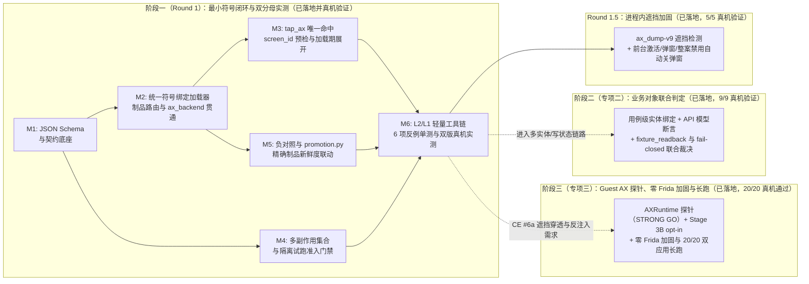

# 受控操作与符号绑定分阶段实施任务书

> **文档状态**：工程实施任务书与落地台账（v1.4，对应分支 `feat/app-symbols-v1`）。本任务书将 [iOS App 受控操作与确定性验证架构蓝图](app-operation-language.md)、[统一 App 符号头文件（`app-symbols.v1`）最小契约规格](app-symbols-v1.md) 与 [Guest 免侵入 AX 观测与双通道静态分治规格](guest-ax-observation.md) 转化为可逐阶段交付、具备明确代码边界与验收门禁的执行计划。当前阶段一（Round 1 M1–M6）、Round 1.5、阶段二（联合裁决 9/9）与阶段三（探针实测 STRONG GO、Stage 3B 接入、零 Frida 运行期加固、20/20 多应用交替长跑、两项复位前置项 `3ed53ebf6` 以及 `DEFAULT_AX_BACKEND` 正式切换为 `"guest_axruntime"` `86825c4a7`）已全部完成落地与验证（`frida_inproc` 保留为显式可选灰盒通道）；同时已完成 `autophone-kernel` 分层解耦（`b6fb78039`，47 个内核模块 0 越层依赖）。运行期硬约束对齐 [回归运行期契约](runtime-contract.md)，全阶段目标 VM 实测结论汇总见 [实测验证报告](app-symbols-v1-validation-report.md)。

---

## 一、已锁定的 8 项架构决策基线（Decision Record）

在动手编码前，以下 8 项边界已全部拍板，实施过程严禁偏离：

| 编号 | 决策主题 | 已拍板结论 |
| :--- | :--- | :--- |
| **D1** | **推进主线** | 采用 **Track A（L2 先行 + 同包 L1 盲测）**：先落地全部离线代码与 6 项反例单测，再基于 `Food Ordering` 构建两版制品在同一台 `vphone` 上完成跨版对照与同包 L1 盲测 |
| **D2** | **绑定与观测拆离** | `app-symbols.v1` 仅保留不可变的 `artifact_identity + controls`（原始文件字节 SHA-256 即 `binding_sha256`）；所有 `relation_claims` 独立存入外部 claims 文件（复用 `knowledge-claims.v1.json` 信封与枚举），消除循环哈希与观测写入导致的证据自失效 |
| **D3** | **步骤语法（路线 A）** | 不新增 `ACTIONS` 动词；扩展 `tap_ax` 补齐 `screen_id` 与 `require_unique`，`Recipe` 写 `action: tap_ax` + `symbol: <id>`（禁混写裸定位/回退参数），由统一加载期绑定器展开冻结并保持 1:1 `step_index` |
| **D4** | **页面预检与遮挡策略** | 复用 `screens.yaml` 作为唯一页面真源（不扩新 Schema），`tap_ax` 点击前做单帧前置核验；首轮不强改 `ax_dump.dylib`，符号步骤禁用 `_dismiss_blocking_overlay_once` 静默绕过，先实测真机弹窗遮挡表现 |
| **D5** | **多版本符号路由** | `symbols/artifacts/<digest>.yaml` 多版本并存；Run 期按 `--build-id` / Package Store / `confirmed` `build-identity` 精确制品摘要自动路由（查不到或摘要不符即 fail-closed）；离线 `case lint` 按 `--build-id` 或当前 promoted 构建解析，无需修改 `profile.yaml` |
| **D6** | **转正新鲜度全局收紧** | `promotion.py` 全局强制校验精确制品内容摘要（缺失精确摘要的旧证据或同版本号换包一律判 `discrimination_stale`）；绑定了符号的资产额外强制校验 `binding_sha256` 一致 |
| **D7** | **多副作用与试跑隔离** | `EffectDecision` 升级为 `verbs` 集合 + `completeness`；多副作用符号动作拒绝 `"irreversible"` 通配符；`active` 硬阻断 `lower_bound`/`unknown`；`draft` 试跑须同时满足 CLI `--trial-draft-recipes --confirm-trial-effects` 与 `profile.yaml` 的 `trial_data_isolation: "isolated"` |
| **D8** | **`ax_backend` 与工具链** | `app-profile.v1.json` 增加 `capabilities.ax.backend`（Round 1 初始默认 `frida_inproc`；Stage 3 20/20 长跑与前置项收口后已于 `86825c4a7` 晋升为默认 `guest_axruntime`，`frida_inproc` 保留显式可选），端到端贯通至 `AxSession`、快照、Run 证据与 `unique_visibility` claim，并修补 `operation-ax-checkpoint.v2.json` 兼容 `build-identity.v2.json`；首轮工具链仅做 L2 薄清单导入 + L1 未加密 RN `main.jsbundle` 最小提取器 |

---

## 二、总体阶段、当前状态与里程碑依赖关系

### 当前落地状态总览（`feat/app-symbols-v1`）

| 阶段 | 代码与离线门禁状态 | 真机 VM 验证状态 | 关键提交与实测依据 |
| :--- | :--- | :--- | :--- |
| **阶段一（Round 1 M1–M6）** | **已落地**（全量契约、运行时门禁、工具链与 6 项反例单测） | **已完成 iOS 26.1 VM 实测**（L2 双版对照、L1 双分母、CE #1–#6） | `3a3641990`、`84b2c1598`；见 [实测验证报告](app-symbols-v1-validation-report.md) |
| **Round 1.5（`ax_dump-v9` 遮挡加固）** | **已落地**（`ax_dump-v9` 与四层遮挡门禁单测） | **已完成 5/5 真机闭环验证**（零误报） | `7c2accebe`；见 [实测验证报告](app-symbols-v1-validation-report.md) |
| **阶段二（业务对象联合判定）** | **已落地**（`entity-binding.v1`、动作后回读、`joint_verdict` 与离线单元/反例单测） | **已完成 `vm-2607` 真机全链路实测（S2-1–S2-7 9/9 全绿）**，含 `guest_axruntime` + `api_capture` 共存及 `build_marker` 确认闭环 | `2a2f61197`、`10b46713f`；见 [实测验证报告](app-symbols-v1-validation-report.md) |
| **阶段三（Guest AX 探针 + Stage 3B 接入与默认切换）** | **已落地**（独立探针、`guest_axruntime` 接入、零 Frida 执行链加固、v2 `build_marker` 确认、两项复位前置项及默认切换为 `guest_axruntime`） | **已完成 `vm-2607` 全链路与 20/20 双应用零 Frida 交替长跑**（46/46 探针 0 失败、0 `Tag: 255`、0 VoiceOver）；`DEFAULT_AX_BACKEND` 已切换为 `guest_axruntime`，`frida_inproc` 保留显式可选灰盒通道 | `6b7621511`、`da026957b`、`46b8870a2`、`10b46713f`、`3ed53ebf6`、`86825c4a7`；见 [实测验证报告](app-symbols-v1-validation-report.md) |

---

## 三、阶段一（Round 1）工程实施任务拆解（M1–M6，已完成并真机验证）

> **阶段一与 Round 1.5 结项说明**：M1–M6 全部任务已于 `3a3641990` / `84b2c1598` 落地并在目标 iOS 26.1 VM 完成真机验证；由 M6 CE #6a 实测暴露的弹窗遮挡穿透问题触发的 Round 1.5（`ax_dump-v9` 遮挡加固）已于 `7c2accebe` 落地并完成 5/5 真机验证。下文保留原始 M1–M6 任务边界与 DoD 记录以备回溯，完整真机实测数据见 [实测验证报告](app-symbols-v1-validation-report.md)。

### M1：JSON Schema 与基础数据契约定义
- **目标**：建立机器校验边界，不触碰运行期分发逻辑。
- **范围与改动文件**：
  1. 新增 `autophone/_data/schemas/app-symbols.v1.json`：
     - 严格限定顶层字段为 `schema`（常量 `"autophone.app-symbols/1"`）、`app`、`artifact_identity`、`controls`（`additionalProperties: false`）；
     - `artifact_identity` 按 `kind` 分支校验：`ipa_build` 必填 `bundle_id`、`short_version`、`build_version`、`build_id`、`artifact_sha256`；`rn_candidate` 必填 `bundle_id`、`short_version`、`build_version`、`base_ipa_sha256`、`main_jsbundle_sha256`、`assets_tree_sha256`；**严禁出现 `target_fingerprint` 或 `relation_claims`**；
     - `controls.<symbol_id>` 校验 `kind`、`scope.{screen_id, region}`、`locator.{kind, identifier, role, enabled_only, require_unique}` 与 `effects.{verbs, completeness}`。
  2. 更新 `autophone/_data/schemas/app-profile.v1.json` 与 `autophone/assets/profile.py`：
     - `capabilities.ax` 新增 `backend`（枚举 `["frida_inproc", "guest_axruntime"]`，默认 `"frida_inproc"`）；
     - 顶层新增可选字段 `trial_data_isolation`（枚举 `["unisolated", "isolated"]`，缺省 `"unisolated"`）。
  3. 更新 `autophone/_data/schemas/operation-ax-checkpoint.v2.json`：
     - `build_identity` 字段由仅引用 `build-identity.v1.json` 升级为 `oneOf` 兼容 `build-identity.v1.json` 与 `build-identity.v2.json`；快照允许可选字段 `ax_backend`。
  4. 更新参考文档生成：运行 `scripts/generate_public_docs.py` 同步 `docs/reference/schemas.md`。
- **完成判据（DoD）**：
  - 新增 Schema 正反例单测（含混入 `target_fingerprint` / `relation_claims` 必拒、`rn_candidate` 三元组校验、`operation-ax-checkpoint` v2 构建身份通过）；
  - `uv run --group platform python scripts/generate_public_docs.py --check` 通过。

---

### M2：统一符号绑定加载器、制品摘要路由与 `ax_backend` 端到端贯通
- **目标**：实现不可变符号文件的定位、哈希冻结、外部 claims 读写与 `ax_backend` 单次运行固定。
- **范围与改动文件**：
  1. 新增 `autophone/assets/app_symbols.py`：
     - 计算标准化制品内容摘要键（原生 IPA 取 `artifact_sha256` 前缀/全量摘要，RN 候选取规范化三元组内容摘要），在 `apps/<app>/symbols/artifacts/` 下精确路由唯一绑定文件；
     - 单次读取原始文件字节计算 `binding_sha256` 并校验 Schema 与 `artifact_identity` 一致性（缺失、多文件冲突或摘要不匹配均抛出确定性校验异常）；
     - 封装外部 `apps/<app>/symbols/claims.json`（基于 `knowledge-claims.v1.json`）的读取与 `confirmed` 运行期 `symbol.unique_visibility` 追加写入；核验复用时强制匹配 `(artifact_content_digest, binding_sha256, screen_id, ax_backend)`。
  2. 贯通 `ax_backend`：
     - 在 `autophone/device/ax_session.py`、`autophone/device/ax_target.py`、`autophone/execution/engine/actions.py`（`ax_snapshot`）及 Run orchestrator 中，于 Run 启动期从 `Profile` 冻结单一 `ax_backend`；
     - 若配置为 `guest_axruntime`，在 Run 启动预检阶段立即 fail-closed 返回明确错误码，不在运行中途回退至 `frida_inproc`（注：此为 Round 1 阶段边界；Stage 3B 已于 `da026957b` 开放 `guest_axruntime` 为受支持的显式 opt-in 后端，其余未知或不支持后端继续在启动预检严格 fail-closed 且禁止运行中途回退）；
     - 将 `ax_backend` 写入保存的 `.ax.json` 快照与 Run 结果元数据。
- **完成判据（DoD）**：
  - 单测覆盖：多版本符号归档按摘要自动路由、篡改文件内摘要 fail-closed、追加外部 `unique_visibility` claim 后 `binding_sha256` 恒定不变、`ambiguous` 构建身份禁止写入 `vm_observation` claim、跨 `ax_backend` claim 不复用、`guest_axruntime` 启动期 fail-closed。

---

### M3：受控定位执行（扩展 `tap_ax`、加载期符号解析与 `screen_id` 单帧核验）
- **目标**：在不新增封闭动作动词的前提下，彻底封死多命中盲点、坐标静默回退、错页误点与遮挡静默绕过。
- **范围与改动文件**：
  1. `autophone/execution/engine/actions.py`：
     - `CaseContext.tap_ax` 新增关键字参数 `screen_id: str | None = None` 与 `require_unique: bool = False`（同步注册至 `recipe.py` 的 `_PARAM_TYPES` 并重生成 `docs/reference/verbs.md`）；
     - 当传入 `screen_id` 时，点击前基于已加载的 `screens.yaml` 执行单帧前置匹配，不匹配立即记录 `kind="screen_mismatch"` 并抛出 `StepFailure`（零点击派发）；
     - 修复唯一性判定：当 `require_unique=True` 或仅按 `identifier` 定位匹配到 `>= 2` 个节点时，记录 `kind="ambiguous_match"`（且当 `require_unique=True` 时忽略任何 `fallback_xy`），匹配 `0` 个节点记录 `kind="locator_missing"`，**两种情形下 UDS 点击派发次数严格为 `0`**。
  2. `autophone/execution/engine/recipe.py`、`autophone/execution/golden_path_binding.py` 与 `autophone/application/case_recipe.py`（`case lint`）：
     - 提供统一的加载期符号解析入口：识别 `{"action": "tap_ax", "symbol": "<id>", ...}`，静态拒绝混写 `identifier`/`role`/`region`/`fallback_xy`/`query`/`enabled_only`，校验 `scope.screen_id` 在该 App 的 `screens.yaml` 中存在，展开为冻结的 `tap_ax(..., screen_id=..., require_unique=True, fallback_xy=None)` 并挂载内部元数据（`symbol_id`、`binding_sha256`、声明 `effects`），保持 1:1 `step_index`；
     - 在 `_dispatch_step` 中，凡携带符号绑定元数据的步骤抛出 `StepFailure` 时，**跳过 `_dismiss_blocking_overlay_once`**，严格 fail-closed；
     - `autophone app case lint` 支持按 `--build-id` 或当前 promoted 构建加载对应符号表完成离线静态校验。
- **完成判据（DoD）**：
  - 离线反例 #2 单测通过：同一 `identifier` + `role` 构造 `0`、`1`、`2` 个节点时，UDS 点击派发次数分别为 `0`、`1`、`0`（`2` 节点报 `ambiguous_match`）；
  - 单测验证：混写 `symbol` + `fallback_xy` 静态报错、`screen_id` 不存在静态报错、运行期 `screen_id` 不匹配零派发报错、符号步骤失败不触发自动关弹窗重试。

---

### M4：多副作用集合与 `lower_bound` / `unknown` 隔离试跑门禁
- **目标**：消除复合不可逆动作漏检与通配符放行后门，把不完整副作用声明严格关在显式授权的隔离草稿试跑内。
- **范围与改动文件**：
  1. `autophone/execution/effects.py`：
     - 修复 `irreversible_marker(text)`（或新增 `irreversible_markers(text)`）返回全部命中的不可逆动词集合（如 `"下单并支付"` 同时返回 `{"place_order", "pay"}`）；
     - `EffectDecision` 升级为包含 `verbs: frozenset[str]` 与 `completeness: Literal["exhaustive", "lower_bound", "unknown"]`（保留单值向后兼容只读属性或平滑迁移调用点）；
     - 符号绑定步骤直接消费 `app-symbols.v1` 中声明的 `effects.{verbs, completeness}`；多副作用符号动作在核对 `allowed_effects` 时**不接受 `"irreversible"` 通配符**，必须每一项 `verb` 均在 `allowed_effects` 中显式列出。
  2. 准入与运行期门禁（`autophone/assets/admission.py`、`autophone/execution/engine/recipe.py`、Run CLI/orchestrator）：
     - `active` 资产审计（`case lint` / 转正准入）与正式回归运行：凡步骤 `completeness` 为 `lower_bound` 或 `unknown`，一律硬阻断（报 `effect_completeness_insufficient`）；
     - `draft` 试跑：仅当同时满足 `--trial-draft-recipes` + `--confirm-trial-effects` **且** `profile.trial_data_isolation == "isolated"` 时允许执行 `lower_bound` / `unknown` 步骤，缺任一条件即在派发前阻断。
- **完成判据（DoD）**：
  - 离线反例 #5 单测全覆盖：`["place_order", "pay"]` 仅授权 `["pay"]` 必拒、仅配 `"irreversible"` 通配符必拒、`lower_bound`/`unknown` 在 `active` 必拒、在 `draft` 缺 `--confirm-trial-effects` 或缺 `trial_data_isolation: "isolated"` 必拒、双条件齐备且 `verbs` 全授权时在 `draft` 试跑放行。

---

### M5：负对照与 `promotion.py` 精确制品新鲜度联动
- **目标**：确保换包（含同版本号重编包）或修改符号绑定后，旧负对照区分力证据立即失效，无区分力弱断言无法转正。
- **范围与改动文件**：
  1. `autophone/assets/negative_control.py`：
     - `judge_negative_control()` 在 `autophone.negctl-probe/2` 产物中完整写入精确制品内容摘要（`artifact_sha256` / `build_id` 或 RN 三元组摘要）以及本次运行冻结的符号 `binding_sha256`（未使用符号时为 `null`）。
  2. `autophone/assets/promotion.py` 及上层调用点（含 `autophone/adapters/http/cases.py` 等）：
     - 升级 `discrimination_gaps()` 与 `evaluate_promotion_gate()` 入参，传入当前目标构建的精确制品身份与当前符号 `binding_sha256`；
     - **全局制品新鲜度规则**：无论资产是否使用符号，探针证据缺失精确制品摘要，或与当前制品内容摘要不一致（即使 `subject_build_key` 版本三元组相同），一律报告 `discrimination_stale`；
     - **符号绑定新鲜度规则**：若当前资产使用了符号绑定，探针证据的 `binding_sha256` 缺失或与当前符号文件 `binding_sha256` 不一致，同样报告 `discrimination_stale`。
- **完成判据（DoD）**：
  - 离线反例 #3 与 #4 单测通过：同版本号 `1.0.0 (1)` 异摘要新包判 `discrimination_stale`、缺少 `artifact_sha256` 的旧探针判 `discrimination_stale`、修改符号文件导致 `binding_sha256` 变更判 `discrimination_stale`、`skip_step` 跳过导航后公共顶栏弱断言仍通过时判 `discrimination_toothless`。

---

### M6：L2 薄清单导入、L1 RN 最小提取器与 `Food Ordering` 双版本实测
- **目标**：补齐最小接入工具链，跑通离线全套门禁与 `Food Ordering` 真机两版对照，产出双分母与维护成本实测账本。
- **范围与改动文件**：
  1. 轻量符号工具链（`autophone/assets/symbol_tools.py` 及对应 CLI 子命令，如 `autophone app symbols import-l2` / `extract-l1-rn`）：
     - **L2 薄清单导入**：读取构建侧清单 JSON + 指定 `--build-id` 的 Package Store 精确制品摘要，生成合规 `apps/<app>/symbols/artifacts/<digest>.yaml` 与初始 `l2_build_manifest` claims；
     - **L1 最小 RN 盲提取器**：从已就绪未加密 IPA 中定位 `main.jsbundle`，提取稳定 `testID` / `accessibilityIdentifier` 候选，生成 `completeness: unknown` 的草稿符号文件与 `l1_ipa_extractor`（`static_hint`）claims（不做原生 Mach-O 静态反编译）。
  2. `examples/food-ordering` 实验资产：
     - 新增 `screens.yaml`（定义 `S01_home` 及偏好页锚点）；
     - 新增“首页 → 调偏好”（`ctrl.home.preferences` → `home.ai_prompt.preferences`）的手写 `Recipe`、符号绑定 `Recipe`、对应的 `Case` 预期断言、`negative_controls.yaml` 以及反例 #6 的独立预期数据配置。
  3. 离线全量门禁与真机双版实测：
     - 离线执行 6 项反例集成测试、代码规范与公开仓库门禁；
     - 基于本机 `Food Ordering` 源码（或 RN candidate 更新 `main.jsbundle`）准备第二版制品（含“改按钮文案不改 ID”与“同版本号异制品”），在同一台 `vphone` 上跑完 L2 两版对照、同包 L1 盲测与顶层弹窗遮挡实证，记录双分母覆盖率与人工维护耗时对比表。
- **完成判据（DoD）**：
  - 离线验证全绿：
    - `uv run --only-group dev ruff check .`
    - `uv run --group platform python scripts/generate_public_docs.py --check && python3 scripts/check_public_content.py`
    - `scripts/test_public_platform.sh`（含新增的 M1–M6 全部单测与 6 项离线反例）
  - 真机实测报告落盘：包含两版制品精确 SHA、6 项反例实证结论、弹窗遮挡在 `frida_inproc` 下的真实观测结果、L1 RN 双分母覆盖率（候选可用率 / 业务目标覆盖率）及手写 vs 符号跨版本维护成本账本。

---

### Round 1.5（已落地，5/5 真机验证）：`ax_dump-v9` 与 `tap_ax` 遮挡加固
- **背景与目标**：针对 Round 1 CE #6a 真机实测暴露的 4 项 `frida_inproc` 弹窗/系统浮层穿透与误关漏洞，在保持零误报的前提下补齐四层进程内遮挡门禁。
- **落地内容（提交 `7c2accebe`）**：
  1. `support/ax-dump/ax_dump.m`（升级至 `dumper_version: 9`）与 `scripts/build_ax_dump.sh`：增加 `accessibilityViewIsModal` 同级遮挡检测，将底层被遮节点标记为 `hittable=False`（`occluded_reason="modal_sibling"`）；
  2. `autophone/assets/screens.py`、`autophone/device/ax_session.py`、`autophone/device/ax_target.py`、`autophone/execution/engine/actions.py` 与 `recipe.py` / `runner.py`：落地无 `screen_id` 场景的前台激活门禁、`screens.yaml` `blocking_overlays` 点击前硬拦截、模态遮挡阻断（`locator_occluded`）以及符号用例整案禁用自动关弹窗重试；
  3. 离线测试（`tests/test_r15_ax_target_session.py`、`tests/test_r15_occlusion_gates.py`）与目标 iOS 26.1 VM 5/5 闭环验真全绿（零误报，详见 [实测验证报告](app-symbols-v1-validation-report.md)）。

---

## 四、阶段二、阶段三落地进展与按需扩展池

### 4.1 阶段二（专项二）：业务对象身份与 API / 数据模型联合判定契约
- **立项触发条件**：阶段一验收完成后，用例扩展至多门店/多商品/多订单列表点击或涉及后端状态写入的业务链路前。
- **核心任务边界**：
  1. 设计用例级业务实体身份绑定规格（区别于不含实体 ID 的类级 `field-binding.v1.json`）；
  2. 将交互窗口内 `api_capture` + `api_mark` 捕获的请求参数/响应模型与 `fixture_readback` 回读结果纳入 `Case` 联合裁决，拦截“页面 `screen_id` 与控件 ID 全对，但点进了错误业务对象或后端未真实落盘”的缺陷。
- **落地与验证进展（已落地，9/9 真机全绿）**：已完成全部离线契约、执行链与反例测试落地（提交 `2a2f61197`），包括 `autophone/_data/schemas/entity-binding.v1.json`、用例级实体绑定解析与 lint（`autophone/assets/entity_binding.py`）、动作后受控回读执行器（`autophone/execution/entity_readback.py`）、API 窗口实体断言扩展（`autophone/observation/frida/api_oracle.py`）、UI × API × 回读 fail-closed 联合裁决（`autophone/observation/joint_verdict.py`）以及 `tests/test_stage2_*.py` 离线单元与反例套件；并已在 `vm-2607` 完成 **S2-1–S2-7 全链路 9/9 真机实测**（覆盖正向、错实体、乐观 UI + HTTP 500、陈旧回读、缺失 API 平面、动作窗口隔离与强/弱联合负对照，同时实证 `guest_axruntime` + Frida `net_tap.js` 共存，并据此闭环修复 v2 `build_marker` 确认链路 `10b46713f`，完整记录见 [实测验证报告](app-symbols-v1-validation-report.md)）。

### 4.2 阶段三（专项三）：Guest 免侵入 `AXRuntime` 探针、Stage 3B 接入与零 Frida 长跑
- **立项触发条件**：遇到带反附加/反注入自检的未加密目标 IPA，或阶段一 M6 真机实测表明 `frida_inproc` 在顶层弹窗遮挡场景下存在无法靠 `screen_id` 前置核验拦住的穿透误点且难以在进程内低成本修复。
- **核心任务边界**：按 [Guest 免侵入 AX 观测规格 §四–§五](guest-ax-observation.md) 执行 `dyld_shared_cache` 符号核验、只读探针编译部署与四项对比实测（控件覆盖率、遮挡识别、失败率与零 `Tag 255` 脏页、P50/P95 延迟）；四项综合达标后再立项合入 `AxSession` 并解耦 `variant_evidence.py`。
- **落地与实测进展（Stage 3 + Stage 3B + 零 Frida 长跑全部完成）**：
  1. **独立探针实测与打包（提交 `6b7621511`）**：已完成 iOS 26.1 目标 VM 四项对比实测并获得 **STRONG GO** 结论，独立探针源码、单条最小权限（`com.apple.accessibility.api = true`）与编译脚本已收口至 `support/guest-ax-probe/` 与 `scripts/build_guest_ax_probe.sh`；
  2. **Stage 3B 显式 opt-in 接入（提交 `da026957b`）**：已新增 `autophone/device/guest_ax_probe.py` 并将 `guest_axruntime` 正式接入 `AxSession`、`CaseContext.tap_ax`、`ax_checkpoint` v2 及 `variant_evidence` / `ax_comparison` 静态分治（附 `tests/test_stage3_guest_axruntime.py`），在 `vm-2607` 上完成自动部署、版本/几何对齐、多应用点击、Home 挂起进程与控制中心前台门禁及零 `Tag: 255` / 零 VoiceOver 全链路真机实测；
  3. **零 Frida 运行期加固、v2 构建标记确认与 20/20 多应用长跑（提交 `46b8870a2`、`10b46713f`）**：消除纯 UI `guest_axruntime` 链路的隐式 Frida 依赖（`need_frida=False`、`crash_trap` 默认关闭、`app_frida_hygiene` 记录 `no_frida_attached` 并跳过无谓强杀、`operation_run` 供应惰性 `AxSession`），补齐 v2 Package Store `build_marker` 实时字节核验以支持 `confirmed` 状态下的 `symbol.unique_visibility` claim 落盘，并在 `vm-2607` 上以纯零 Frida 环境完成 `Food Ordering` 与 `ios-settings-smoke` 20/20 双应用交替长跑（46/46 探针 0% 失败、P50 `267.14 ms`、全部 `0` `Tag: 255`、`0` VoiceOver，完整数据见 [实测验证报告](app-symbols-v1-validation-report.md)）；
  4. **默认后端正式切换（提交 `86825c4a7`）**：在完成 20/20 多应用零 Frida 长跑及两项运维前置项（`RigMaintenance._reset_home_and_probe()` `reset: relaunch` 回退与 `examples/ios-settings-smoke` 根页独有 `ready_markers`，提交 `3ed53ebf6`）后，`DEFAULT_AX_BACKEND` 与 `app-profile.v1.json` 已于提交 `86825c4a7` 正式切换为 `"guest_axruntime"`（开箱零 Frida 默认，`crash_trap` 默认关闭）；`frida_inproc` 继续保留为显式可选后端（`capabilities.ax.backend: frida_inproc`）服务于 `api_capture`、`core_location_authorization`、`modal_sibling` 等进程内灰盒诊断（另于 `b6fb78039` 完成 `autophone-kernel` 分层解耦，确保核心内核包零越层依赖）。

### 4.3 按需扩展池（无痛点不立项）
- **受限 `$param`**：仅当同一 App 出现 `>= 3` 个结构完全重复、仅字面参数不同的具参 `Operation` 时再设计；
- **受限 `routes`**：仅当长链路前置 UI 导航耗时成为实测回归瓶颈时再引入前置造数/受控跳屏（严禁替代被测主路径本身的交互）；
- **原生闭源包静态提取器**：仅当外部交付明确以无源码纯原生 Swift/ObjC IPA 为主且双分母摸底证明静态提取 ROI 为正时再投入。
