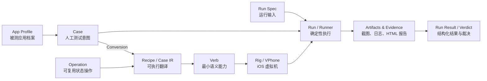

# 核心术语与概念模型

本文解释 Autophone 公开核心中的高频英文名词、相互关系与代码落点。

## 资产与执行全链路

一句话关系：**`Case` 定义测什么，`Recipe` 定义怎么执行，`Operation` 复用状态构建，`Verb` 真正操作设备；`Run` 按 `Run Spec` 驱动执行，沉淀 `Artifacts` 与 `Evidence`，输出确定性 `Verdict`。**

## 核心测试资产

| 术语 | 含义 | 落点 |
| --- | --- | --- |
| **App Profile** | 被测 App 档案，声明 `bundle_id`、复位策略与能力边界 | `apps/<app>/profile.yaml` |
| **Case** | 人类可读的业务测试真源（前置、步骤、预期、生命周期状态） | `apps/<app>/cases/*.yaml` |
| **Recipe / Case IR** | Case 的封闭型可执行翻译，只允许调用白名单 `action` 或注册 `operation` | `apps/<app>/recipes/*.yaml` |
| **Operation** | 可复用的目标导向状态操作（如打开特定页面、登录、复位） | `apps/<app>/operations/` |
| **Verb** | `CaseContext` 提供的原子语义动作（如 `tap_text`、`wait_text`、`assert_present`） | `autophone/execution/engine/actions.py` |
| **Asset Lifecycle** | 资产状态机：`draft → active → deprecated → archived` | Case / Operation / Recipe |
| **Automation Level** | 执行就绪度分类：`ui_ready`、`needs_fixture`、`blocked_by_infra`、`manual_checkpoint` | Case 字段 `automation` |

## 运行与观测对象

| 术语 | 含义 |
| --- | --- |
| **Run Spec** | 一次 Run 的不可变输入声明（`app`、`device`、`type`、`case_selector`、`planes`），见 `run-spec.v1.json` |
| **Run Result** | 执行后落盘的结构化结论（`status`、逐条 Case 结果、Rig 快照与包身份），见 `run-result.v1.json` |
| **Plane** | 观测面策略与裁决维度（`ui`、`function`、`api`、`telemetry`），支持 `required` / `advisory` / `disabled` |
| **Artifact Manifest** | 每次 Run 的产物清单，为每份截图、日志与抓包声明敏感度与 AI 外发策略 |
| **Version Slot / Build Record** | Package Store 按 `CFBundleShortVersionString` 分配稳定 Slot，每次入库生成不可变 Build ID |

## 设备与控制面（Host、Guest、VPhone、Rig）

| 术语 | 含义 |
| --- | --- |
| **Host** | 运行 macOS、`vphone-cli` 与 Autophone 宿主进程的物理机 |
| **Guest** | 运行在虚拟机内的越狱 iOS 系统及辅助服务（`vphoned`、区域探针等） |
| **VPhone** | 一台 iOS 虚拟机实例（镜像目录、`config.plist`、`vphone.sock`） |
| **Rig** | 一台 VM 及其 `DeviceTarget` 配置、独立端口、运行目录和 `Rig Agent` 执行单元 |
| **Control Plane** | 基于 PostgreSQL 的调度与状态真源（`autophone-control`），管理多 Rig 注册、Lease、派单与隔离 |
| **ScreenLock** | 单台设备的触屏执行串行锁；确保自动化 Run、远程控制台与网页录制互不抢屏 |
